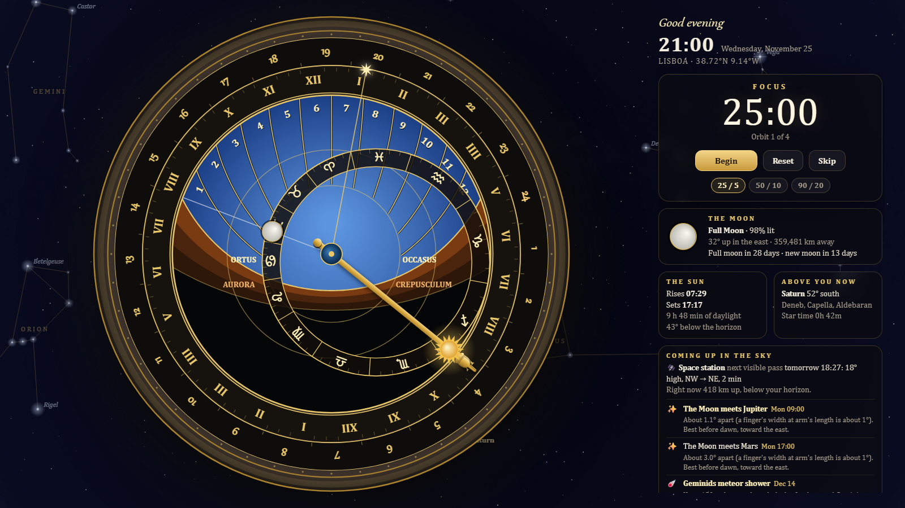

# Orloj

A focus clock built like the Prague astronomical clock (1410), set for Lisbon and worked out live from real astronomy.

Open `index.html` in any browser. Nothing to install; the internet is only used to fetch the space station's orbit.

## The dial
An astrolabe: the sky projected from the south celestial pole, north pole at the centre, south (noon) at the top.
- Blue day sky, orange twilight (AURORA, CREPUSCULUM), black night, the horizon in gold.
- The twelve unequal (Babylonian) hours as curved golden lines.
- The zodiac ring (the ecliptic), turning once a sidereal day.
- The Sun on the golden hand, pointing to your clock time on the Roman ring (the ring is turned so the real Sun position and your clock time agree).
- The Moon on its hand with its real phase; the star hand for sidereal time.
- Old Bohemian time in the gothic outer ring: hour 24 is sunset.
- The gold band round the edge fills as your focus session runs; a bell tolls at the end.

Behind it: the real sky over you (bright stars, constellations, the Milky Way, planets, Moon), twinkling, with the odd shooting star.

## Sky events
**Coming up in the sky** (side panel), all worked out on your computer from the same astronomy:
- Solar and lunar eclipses, and whether you can see them from your place (checked against real eclipses: 12 Aug 2026 about 90% from Lisbon, 2 Aug 2027 total from Cádiz, the 26 Jan 2028 annular at sunset over Portugal).
- Meteor showers, with how much the Moon spoils them; the Moon meeting planets and planets meeting each other; Mars, Jupiter and Saturn at opposition; equinoxes and solstices; supermoons.
- On the day of a big event the bell rings once with a note.

**The space station.** Its orbit (public data from CelesTrak, `gp.php?CATNR=25544&FORMAT=json`) is fetched at most twice a day and kept for offline use. Nothing about you is sent: the passes over your place are worked out here. The panel shows the next visible pass (time, height, direction), the bell rings 5 minutes before a good one, and while the station is up it glides across the background sky (dim red when in the Earth's shadow). A day-old orbit moved forward lands within about 0.3 km of the newer one, so pass times are good to well within a minute. After a failed download it waits 2 hours before asking again, as CelesTrak requests.

## The focus clock
Focus and breaks (25/5, 50/10, 90/20, or your own), a long break every fourth orbit, a record of minutes and orbits per day, a week chart and a streak. During focus, leave the mouse alone for 6 seconds and everything but the dial and the time fades.

Keys: Space start or pause · R reset · S skip · F full screen · 1, 2, 3 presets.

Settings (bottom of the side panel): your name, place, latitude and longitude, lengths, auto-start, bell. Kept in the browser's storage.

## Files
`astro.js` positions (Sun, Moon, planets, sidereal time, sunrise and sunset, Moon phases) · `stars.js` bright stars and constellation lines · `orloj.js` the dial · `sky.js` the background sky · `events.js` eclipses, showers, meetings, seasons · `iss.js` the space station · `app.js` the timer and the panels.

To preview another moment: `index.html?at=2026-12-21T17:00`.

## Credits
- Sun and Moon: low-precision formulas after J. Meeus, *Astronomical Algorithms* (2nd ed., Willmann-Bell, 1998), ch. 25 and 47, and the USNO Astronomical Almanac.
- Planets: E. M. Standish, "Approximate Positions of the Planets", JPL Solar System Dynamics (ssd.jpl.nasa.gov).
- Star positions: Hipparcos / Yale Bright Star Catalogue values, rounded.
- Meteor shower dates and rates: International Meteor Organization calendar.
- Space station orbit: GP data courtesy of CelesTrak (celestrak.org), fetched under its usage policy.
- Inspired by the Prague astronomical clock (Pražský orloj, 1410).

## License
MIT, see [LICENSE](LICENSE).
